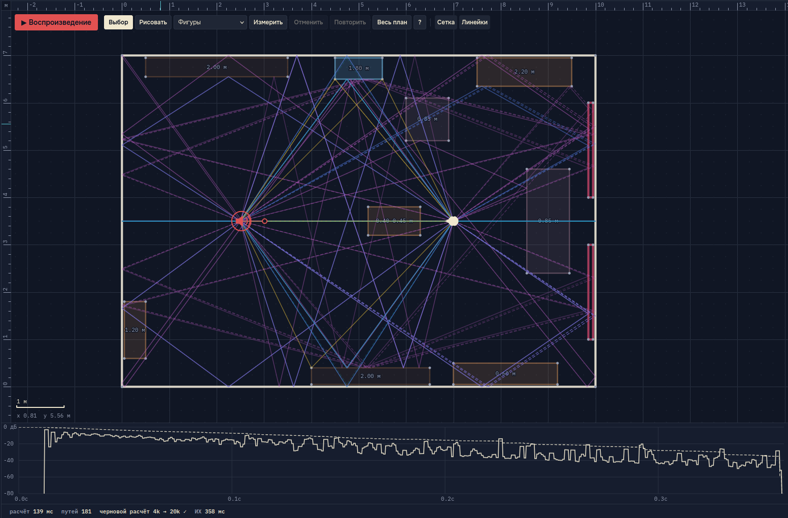

# Acoustic Ray Tracing

Браузерный симулятор акустики помещений. Приложение позволяет построить план комнаты, разместить источники звука и слушателя, выбрать тестовый сигнал или загрузить аудиофайл и прослушать в наушниках, как звук распространяется в этом помещении. Все вычисления выполняются локально в браузере (Rust и WebAssembly в веб-воркере); серверная часть не требуется.

**Онлайн-версия:** https://olegzlobin.github.io/acoustic-ray-tracing/



## Локальный запуск

Нужны [Node.js](https://nodejs.org/) 20+ и [Rust](https://rustup.rs/) с таргетом WebAssembly:

```bash
rustup target add wasm32-unknown-unknown
npm install
npm run dev
```

Команда `npm run dev` собирает ядро в `src/wasm/core.wasm` и запускает сервер разработки Vite. Адрес приложения выводится в консоль (обычно http://localhost:5173). Для корректного прослушивания рекомендуется использовать наушники.

Дополнительные команды:

- `npm run build` — сборка для публикации;
- `npm run preview` — просмотр собранной версии;
- `npm run test:all` — запуск тестов Rust и TypeScript.
